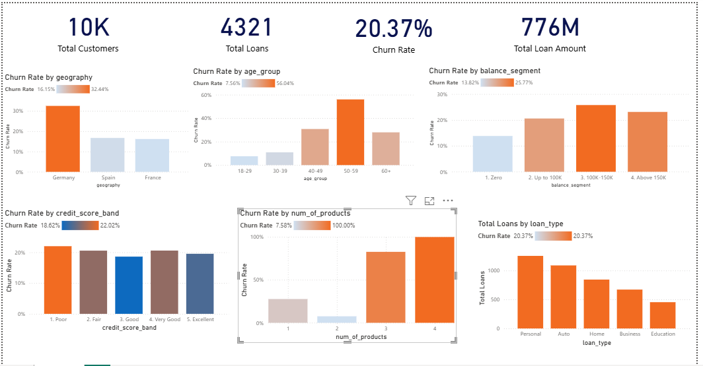
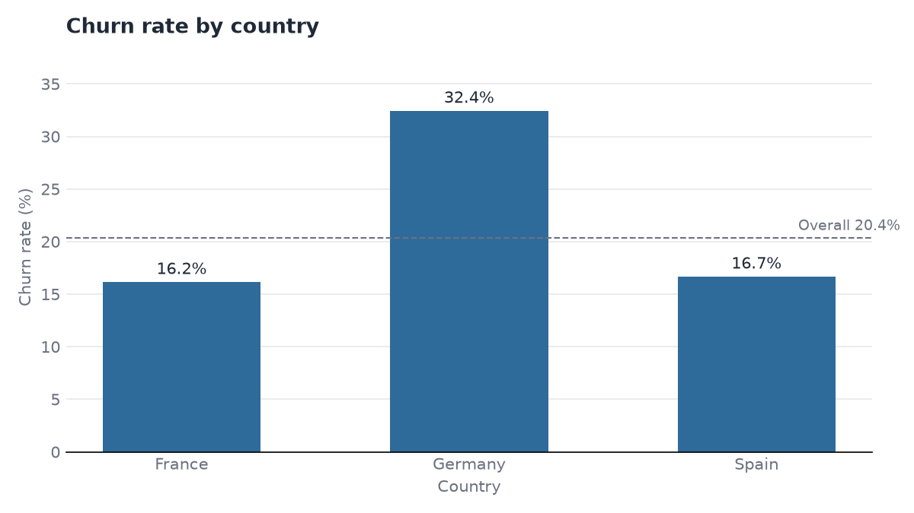
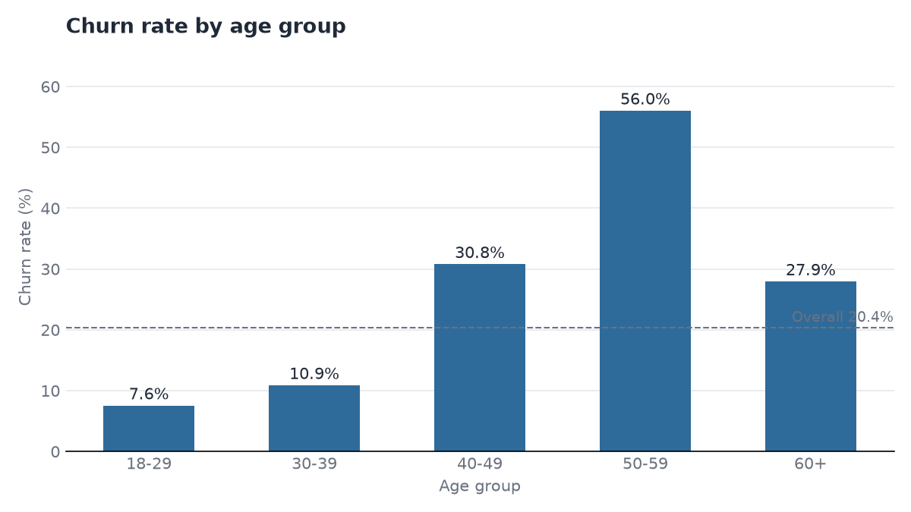
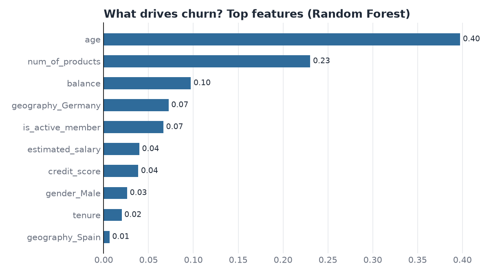

# Bank Customer Churn & Loan Portfolio Analysis

An end-to-end analytics project that finds **why bank customers leave**, **which loans are most likely to
default**, and **which valuable customers the bank should call first**, using **Python, SQL, Excel and Power BI**.

> **Data note:** customer data is the public Kaggle *Bank Customer Churn* dataset (10,000 customers).
> The Kaggle file has no loan information, so the **loan table is simulated** by `python/02_generate_loans.py`
> (fixed random seed, documented rules). Churn findings come from real data; loan findings demonstrate the method.

## Business problem

Winning a new customer costs far more than keeping an existing one. The bank wants to know:

1. Who is leaving, and how much money leaves with them?
2. Which customer segments (country, age, products, activity) churn the most?
3. Which loan types and borrower profiles carry the highest default risk?
4. Which high-value customers are about to leave and still hold active loans?

## Tools and what each one does

| Tool | Used for |
|---|---|
| **Python** (pandas, scikit-learn, matplotlib) | cleaning, feature engineering, EDA charts, churn prediction model, loan simulation |
| **SQL** (SQLite, standard SQL) | KPI queries, joins, CTEs, window functions, a customer-360 view |
| **Excel** | formula-driven KPI sheet, pivot tables, quick summary charts |
| **Power BI** (DAX) | interactive dashboard |

## Project workflow

```
Kaggle CSV -> 01 clean -> 02 loan table -> 03 EDA charts -> 04 churn model
                                                 |
                  05 load to SQL database  <-----+-----> 06 Excel workbook
                                                 |
                                         Power BI dashboard
```

## Repository structure

```
bank-analytics-project/
├── data/
│   ├── raw/                 # put Churn_Modelling.csv here (not uploaded to git)
│   └── processed/           # cleaned customers, simulated loans, model scores
├── python/
│   ├── 01_clean_data.py
│   ├── 02_generate_loans.py
│   ├── 03_eda_charts.py
│   ├── 04_churn_model.py
│   ├── 05_load_to_sqlite.py
│   └── 06_export_excel.py
├── sql/
│   ├── 01_schema.sql
│   ├── 02_analysis_queries.sql        # SQLite
│   └── sql server/                    # SQL Server versions of load + analysis queries
├── excel/                   # workbook + EXCEL_GUIDE.md
├── powerbi/                 # .pbix, DAX_MEASURES.md, DASHBOARD_GUIDE.md
├── images/                  # charts and dashboard screenshots
├── reports/                 # auto-generated key_insights.md
├── requirements.txt
└── README.md
```

## How to run

```bash
pip install -r requirements.txt

# 1. Download Churn_Modelling.csv from Kaggle into data/raw/
python python/01_clean_data.py
python python/02_generate_loans.py
python python/03_eda_charts.py
python python/04_churn_model.py
python python/05_load_to_sqlite.py     # creates data/bank.db for the SQL queries
python python/06_export_excel.py       # creates excel/bank_analytics_summary.xlsx
```

Then run `sql/02_analysis_queries.sql` in any SQLite viewer, and open Power BI using
`powerbi/DAX_MEASURES.md` and `powerbi/DASHBOARD_GUIDE.md`.

## Dashboard preview

<!-- Save a screenshot of the Power BI dashboard as images/bank_churn_dashboard.png -->


## Key insights

- Overall churn rate is **20.4%** (2,037 of 10,000 customers left).
- **Germany** churns the most: **32.4%** vs 20.4% overall.
- Customers aged **50-59** churn at **56.0%**, the highest of any age group.
- Customers with **4 products** churn at **100%**, and inactive members churn at **26.9%** vs 14.3% for active members.
- Churned customers held **24.3%** of all balances (about 185.6M in total), the money that walked out.
- Loans (simulated): overall default rate is **9.8%**, with **Home** loans highest at **19.5%**.




## Churn prediction model

A Random Forest (compared with a Logistic Regression baseline) predicts churn from 10 customer features.
Each customer receives a churn probability and a **Low / Medium / High** risk level. Scores are generated
with 5-fold cross-validation, so no customer is scored by a model that trained on them.

| Model | Accuracy | Precision | Recall | F1 | ROC-AUC |
|---|---|---|---|---|---|
| Logistic Regression | 0.714 | 0.387 | 0.700 | 0.499 | 0.777 |
| **Random Forest** | **0.809** | **0.522** | **0.732** | **0.609** | **0.863** |

The Random Forest finds about **73% of the customers who actually leave**. It flags **1,534 customers as High risk**
(holding about 149.9M in balances), and about 70% of them did leave.



## Recommendations

1. **Target Germany and the 50-59 age group** with a retention offer. They churn at 32.4% and 56.0%, far above the 20.4% average.
2. **Re-engage inactive members** (26.9% churn vs 14.3% for active) before they leave, for example with product bundles or check-in calls.
3. **Call the High-risk, high-balance customers first.** 1,534 customers are High risk and hold about 149.9M in balances.
4. **Review the 3-4 product offering.** Customers with 4 products all churned, so find out whether these bundles cause problems.

## Limitations

- Loan data is simulated, so loan results show the analysis method and not real-world default behaviour.
- The churn dataset has no dates, so trends over time are not possible for churn.
- The model uses a standard threshold; a real bank would tune it using the cost of a lost customer vs the cost of a retention offer.

## Author

**Khadiza**: Finance & Banking background (BBA, MBA) moving into data analytics.
Email: khadizabristy371@gmail.com · [LinkedIn](https://www.linkedin.com/in/khadiza-akter-04b500395)